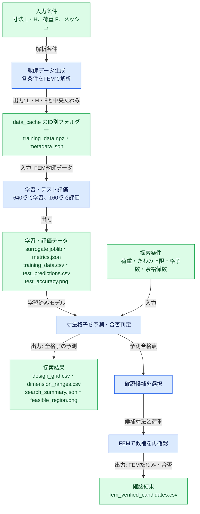
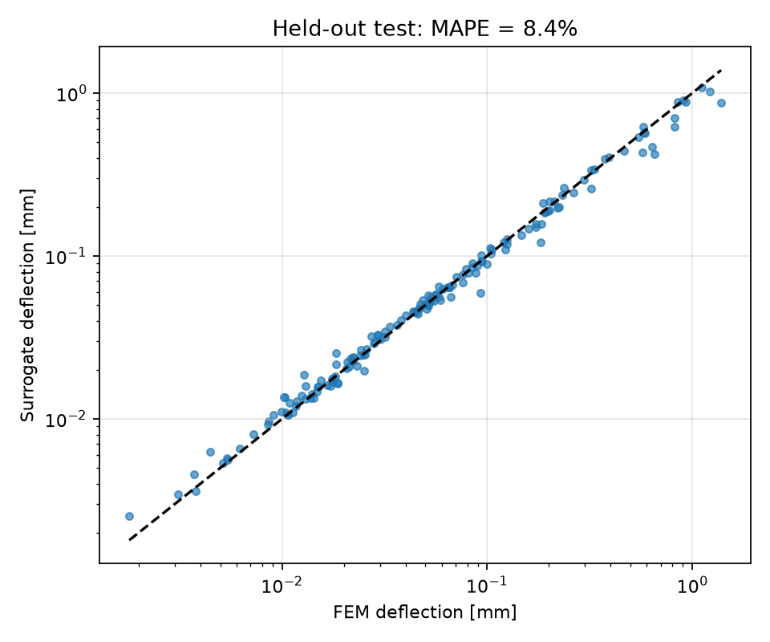
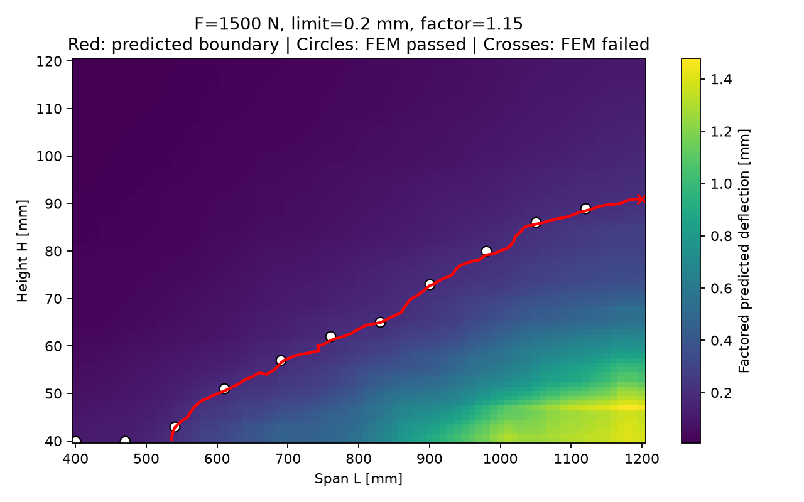
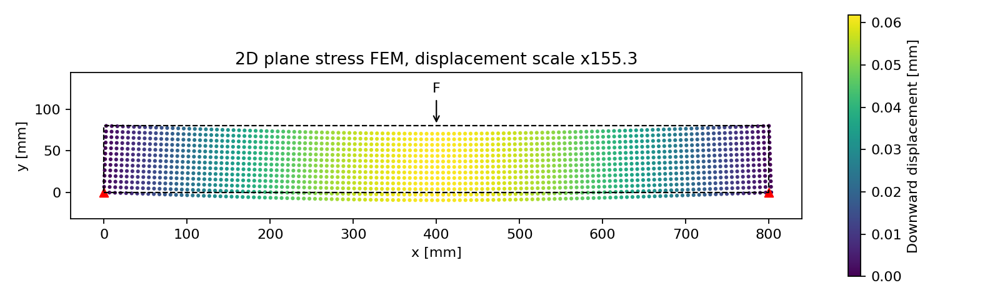

# 2次元FEMから作るはりのサロゲートモデル

この資料では、**2次元の構造FEMで教師データを作り、決定木系の機械学習で中央たわみを予測し、たわみ制約を満たす寸法の組合せを探します。** コマンドを実行し、出力されたCSVや図を見ながら、FEMとサロゲートモデルの特徴を確かめてください。主な処理は `beam_surrogate.py` にまとまっています。

## 1. 最初に実行する

uvをインストールし、このフォルダーをターミナルで開きます。以下はWindows PowerShellの例です。`uv sync` は `.python-version` で指定されたPython 3.14の仮想環境を作り、`uv.lock` に記録された依存ライブラリをインストールします。Python 3.14が未導入の場合、uvがダウンロードします。仮想環境の有効化操作は不要です。

```powershell
uv sync --locked
uv run --locked python beam_surrogate.py
```

引数なしで、FEMを800回実行 → 学習 → 寸法探索 → 候補のFEM再確認まで進みます。初期条件は **荷重1,000 N、たわみ上限0.5 mm** です。実行時間はPCに依存します。

macOS/Linuxでも同じ `uv run` コマンドを使えます。`--locked` はロックファイルが最新であることを確認し、変更せずに実行します。

2回目からは、保存済みモデルを使って荷重と上限を変えられます。

```powershell
uv run --locked python beam_surrogate.py predict --force 1500 --limit 0.2
```

このとき再学習は不要です。結果ファイルは `output` に保存され、同名ファイルは上書きします。残したい結果はフォルダーごとコピーしてください。`--output` はモデルの保存先・読込先の両方を指定します。

### 1.1 処理・データのフロー

標準の `demo` は、教師データ生成から寸法探索までを続けて実行します。各コマンドを個別に実行することもできます。
**青は処理、緑はデータ**です。矢印に、処理へ渡す入力と処理から得られる出力を記しています。



`generate-data` はFEM教師データをキャッシュし、`train` はそのデータからモデルと精度評価結果を作ります。`predict` はモデルで探索格子を予測し、選んだ候補だけをFEMで再確認します。`fem` は学習済みモデルを使わず、指定した1条件を解析します。

## 2. 解析対象と単位

```text
                         F [N]（下向き）
                             ↓
    y       ┌────────────────●────────────────┐  y=H
    ↑       │                ○                │
    │     H │     ○の鉛直変位を中央たわみとする │
    └→ x    └─────────────────────────────────┘  y=0
           ピン                             ローラー
         ux=uy=0                            uy=0
            |<------------- L ------------->|
```

| 項目 | この教材の定義・初期値 |
|---|---|
| 横寸法 L | 支点間長さ。400～1,200 mm |
| 縦寸法 H | はりの高さ。40～120 mm |
| 面外厚さ t | 20 mm固定。断面は t × H |
| 荷重 F | 上面中央の1節点への下向き集中荷重。100～2,000 N |
| 材料 | ヤング率210,000 MPa、ポアソン比0.3 |
| 支持 | 左下をピン、右下を水平方向に自由なローラーで支持 |
| たわみ | x=L/2, y=H/2 の節点の下向き変位。正の値で表示 |
| 解析 | 微小変形・線形弾性・平面応力。4節点四角形要素、2×2ガウス積分 |
| メッシュ | L方向120分割、H方向12分割。どちらも偶数 |

**「縦横」は断面の幅と高さではなく、上図のLとHです。** 材料と厚さは今回は入力変数に含めません。2次元連続体のFEMであり、1次元はり要素や、はり理論の式を教師データとして代用していません。

集中荷重を加えた上面節点は局所的にも変形します。その影響と区別しやすいよう、出力のたわみは中央断面の高さ中央で測ります。応力の特異性があるため、集中荷重点・支持点の局所応力の評価には使いません。

## 3. 何を学習するのか

入力は `[L, H, F]`、正解は `FEM中央たわみ` です。データ作成とモデル学習は別コマンドです。Latin Hypercube Samplingで3変数の範囲を覆い、**各点で独立にFEMを解きます**。同じ条件のコピーや、荷重比によるデータの水増しは行っていません。

まずFEM教師データを生成します。生成条件（点数、材料・メッシュ・寸法・荷重範囲、乱数シード）から16桁の `dataset-id` が付き、`data_cache/<dataset-id>/` にデータと条件メタデータが保存されます。同じ条件で再実行するとFEMを解き直さずキャッシュを使います。条件が異なれば別ID・別フォルダーになります。

```powershell
uv run --locked python beam_surrogate.py generate-data --samples 800
# メッシュなどの条件を変えたデータセットも別IDで保存
uv run --locked python beam_surrogate.py generate-data --samples 800 --nx 60 --ny 6
```

次にキャッシュ済みデータで学習します。省略時は現在の点数と解析条件に対応するIDを選びます。特定のIDを指定すると、そのキャッシュに記録された点数・解析条件を読み込んで学習します。

800点のうち640点を学習、160点を未学習テストに割り当てます。入力・正解を対数変換して学習し、予測を指数関数でmmに戻します。正のたわみを扱い、相対的な誤差を学習しやすくするためです。

既定モデルは **ExtraTreesRegressor**（多数の決定木を組み合わせるExtra Trees）です。ランダムフォレストにも切り替えられます。

```powershell
uv run --locked python beam_surrogate.py generate-data --samples 1600
uv run --locked python beam_surrogate.py train --samples 1600 --model random-forest --output output_rf
uv run --locked python beam_surrogate.py train --dataset-id 生成時に表示されたID --output output_rf
uv run --locked python beam_surrogate.py predict --force 1000 --limit 0.1 --output output_rf
```

`train` はキャッシュがない場合にエラーを表示します。先に同じ点数・解析設定で `generate-data` を実行するか、生成時に表示された `dataset-id` を指定してください。データ生成条件と学習モデルの種類は別に管理されるため、同じキャッシュからExtra Treesとランダムフォレストの両方を学習できます。

学習の前処理・モデル学習にテストの正解値は使用しません。テストを繰り返し見てモデルやパラメーターを選ぶ場合は、別途検証用データを用意してください。

### 3.1 ExtraTreesRegressorとは

**ExtraTreesRegressor（エクストラツリーズ回帰器）は、分岐の作り方が異なる多数の決定木を組み合わせ、数値を予測するモデルです。** Extra Treesは「Extremely Randomized Trees」の略です。この教材では、寸法と荷重から中央たわみという連続した数値を予測するので、分類器ではなく回帰器を使います。

1本の決定木は、「長さがある値以下か」「高さがある値以下か」と条件分岐を重ね、入力条件を小さな領域に分けます。分岐の終点を**葉**と呼び、この教材の既定設定では、その葉に入った学習データの正解値の平均を予測に使います。

Extra Treesでは、分岐のしきい値の候補をランダムに作り、その候補の中から正解値のばらつきをよく減らす分岐を選びます。分岐をすべて無条件にランダムに決めるわけではありません。こうして異なる木を多数作り、それぞれの予測を平均することで、1本の木に依存する予測のばらつきを抑えます。[公式解説：Extremely Randomized Trees](https://scikit-learn.org/stable/modules/ensemble.html#extremely-randomized-trees)

ランダムフォレストとの主な違いは、**しきい値の決め方**と**各木に渡す学習データ**です。以下は、この教材で使うscikit-learnの設定での比較です。

| 項目 | ExtraTreesRegressor | RandomForestRegressor |
|---|---|---|
| 分岐のしきい値 | ランダムに作った候補の中から良いものを選ぶ | 対象特徴量の候補しきい値を調べ、良いものを選ぶ |
| 各木に渡すデータ | 学習用640点をすべて使う（既定の `bootstrap=False`） | 学習用640点から重複を許して抽出する（既定の `bootstrap=True`） |
| 分岐で候補にする入力 | この教材ではL・H・Fの3つすべて | この教材ではL・H・Fの3つすべて |
| 木の本数 | 300本 | 300本 |
| 予測のまとめ方 | 各木の出力を平均する | 各木の出力を平均する |

ここでいう「すべてのデータ」は学習用640点であり、評価用160点を含みません。分岐に使う入力の数は両モデルとも既定の `max_features=1.0` を使っています。Extra Treesのほうが常に高精度・高速とは限らないため、この教材では同じテスト条件で比較してみてください。パラメーターの詳細は [ExtraTreesRegressorの公式リファレンス](https://scikit-learn.org/stable/modules/generated/sklearn.ensemble.ExtraTreesRegressor.html) と [RandomForestRegressorの公式リファレンス](https://scikit-learn.org/stable/modules/generated/sklearn.ensemble.RandomForestRegressor.html) を参照してください。

### 3.2 この教材の設定と予測の流れ

`beam_surrogate.py` は、次の設定でExtra Treesを学習します。

```python
model = ExtraTreesRegressor(
    n_estimators=300,   # 300本の決定木を組み合わせる
    min_samples_leaf=1, # 葉に残す学習点数の下限。細かい分岐も許す
    random_state=42,    # 乱数シードを固定して比較しやすくする
    n_jobs=-1,          # 利用可能なCPUを使って木の処理を並列化する
)
```

葉の最小点数が1なので、学習データには細かく合わせられます。その分、未学習条件での誤差をテストで確認することが大切です。木の本数を増やしても、教師データの不足やFEM自体の近似誤差が自動的に解消するわけではありません。

学習・予測は次の順序です。

```text
学習： [L, H, F] → 自然対数に変換 ─┐
                                  ├→ 300本の木を学習
       FEMたわみ → 自然対数に変換 ─┘

予測： 新しい[L, H, F] → 自然対数に変換 → 各木が対数たわみを予測
       → 300本の出力の平均 → expでmmに戻す → 予測たわみ
```

つまり、**この教材で平均しているのは「対数たわみ」の予測値**です。mm単位の各木の予測を直接平均する処理とは異なります。学習後は剛性行列を組み立てたり連立方程式を解いたりせず、木の分岐をたどって予測します。

一方、モデルは材料力学の式や荷重比例則を組み込んでいません。入力範囲の外への外挿や、「高さを増やせば必ずたわみが減る」といった単調性も、この実装では保証しません。寸法探索で段差や小さな飛び地が現れることがあるのは、このような木による近似の性質も関係します。

### 3.3 図で予測精度を確認する



**横軸はFEMのたわみ、縦軸はサロゲートの予測たわみで、各点がテスト条件1件です。** 黒い破線は両者が完全に一致する位置を表します。点が破線に近いほど予測がよく合っています。

- 破線より上の点：実際のFEM値より大きくたわむと予測しています。
- 破線より下の点：FEM値より小さく予測しています。たわみ上限を満たすか判断するとき、見逃しにつながり得る方向です。
- 両軸は対数目盛です。同じ距離のずれでも、mmでの絶対誤差ではなく、比率のずれに着目して読みます。

掲載例はテスト160点の平均絶対パーセント誤差（MAPE）が約8.4%、R2が約0.950です。MAPEは各点の `|予測値−FEM値| / FEM値` を平均して百分率にした値で、全点が8.4%以内という意味ではありません。この例の最大相対誤差は約45.5%あり、平均的によく合っていても、採用する寸法付近での確認が必要です。

## 4. 寸法範囲の意味と読み方

ユーザーの指定したFを固定し、LとHを各81点、合計6,561通り探索します。

```text
余裕を見込んだ予測たわみ = モデルの予測たわみ × 余裕係数
予測合格 = 余裕を見込んだ予測たわみ <= 指定した上限
```

余裕係数は既定で1.15です。信頼区間や保証された安全率ではありません。1.15を掛けても不合格の見逃しが起こり得ます。

`dimension_ranges.csv` の読み方は次のとおりです。

| 列名 | 意味 |
|---|---|
| length_mm | この行の支点間長さ |
| height_min_mm | この長さで予測合格する高さ区間の下端 |
| height_max_mm | 同区間の上端 |
| grid_points_in_interval | 区間に含まれる探索格子点の数 |

**LとHは組合せで判定します。** 全行の最小・最大だけを抜き出して「この長さ範囲、この高さ範囲ならすべて合格」と読むことはできません。学習モデルに飛び地があれば、同じLに対して複数行を出力します。グリッド間の連続した寸法や未検証の点についても合格は保証しません。判定の対象はCSVに列挙した格子点です。

`feasible_region.png` には予測たわみ分布と赤い予測境界を表示します。赤線は格子点間を補間した可視化です。白丸はFEM再確認で上限以内だった点、赤い×は上限を超えた点です。



**横軸が支点間長さL、縦軸が高さH、色が「予測たわみ×余裕係数」[mm]です。** 掲載例は荷重1,000 N、上限0.5 mm、余裕係数1.15の結果です。色の数値はFEMの全点計算結果ではなく、サロゲートの予測に係数を掛けた値です。

この例では、図の上側の濃い紫の領域ほどたわみが小さく、右下の黄色い領域ほど大きく予測されています。長いはりほど高さを増やす必要がある傾向を読み取れます。赤線は係数を掛けた予測値が0.5 mmとなる境界で、この図では主に赤線より上側が予測合格側です。左側の短いはりでは、表示した高さ範囲がすべて予測合格になっています。

白丸と赤い×は、選ばれた候補を別途FEMで解き直した結果です。この例では12点中2点が赤い×になっています。**予測合格側にもFEM不合格点がある**ことを示し、余裕係数1.15だけでは誤判定を完全に防げないことが分かります。赤線付近の採用候補は特に確認してください。

予測合格のうち、長さごとの下限高さ付近と予測最小体積候補から最大12点をFEMで再確認し、`fem_verified_candidates.csv` に結果を保存します。`fem_pass=True` は今回のメッシュでのFEM合格です。全候補の検証、連続空間の最適化、実物の強度保証ではありません。

```powershell
# 格子を細かくし、余裕係数と再確認数を増やす
uv run --locked python beam_surrogate.py predict --force 1800 --limit 0.15 --grid 121 --safety-factor 1.3 --verify 20
```

学習範囲外の荷重はエラーにします。寸法も学習時に設定した範囲内だけを探索します。材料、厚さ、寸法範囲を変える場合は `Settings` を編集して再学習してください。`predict` はモデル内に保存された解析設定を使います。

## 5. 出力ファイル

| ファイル | 用途 |
|---|---|
| training_data.csv | L、H、F、FEMたわみ、学習/テストの区別 |
| data_cache/<dataset-id>/training_data.npz | FEM教師データの再利用用キャッシュ |
| data_cache/<dataset-id>/metadata.json | データ生成条件、ID、FEM計算時間 |
| dataset_metadata.json | 学習に使用したキャッシュの条件 |
| surrogate.joblib | 学習済みモデルと解析設定 |
| settings.json | 教師データを作成したときの解析設定 |
| metrics.json | テスト誤差、R2、変数重要度、データ生成時間 |
| test_predictions.csv | テスト条件ごとのFEM値と予測値 |
| test_accuracy.png | テストの正解と予測の散布図 |
| dimension_ranges.csv | 長さごとの高さ範囲（予測） |
| design_grid.csv | 全探索点の寸法、予測値、係数適用値、予測合否 |
| fem_verified_candidates.csv | 抜き出した候補のFEM再確認結果 |
| search_summary.json | 荷重、制約、格子間隔、予測合格数、再確認結果 |
| feasible_region.png | 寸法とたわみの関係・予測境界・確認点 |

CSVはExcelでも開きやすいUTF-8 BOM付きです。図中の表記は、日本語フォントのないPCでも文字化けしないよう英語にしています。

README内の図は `output` 内のPNGを相対パスで参照しています。`train` は精度の図、`predict` は寸法探索の図、`fem` は変形図を更新します。引数なしの実行では変形図は生成しないため、3つの図をそろえるには第1節の実行に加えて第6節の `fem` コマンドも実行してください。`--output` で別のフォルダーを指定した場合、このREADMEが参照する図は自動では切り替わりません。図の条件は各図のタイトルと対応する実行条件を確認してください。本文の数値は掲載時の既定条件の例です。

`joblib` は信頼できる自分の実行結果だけ読み込んでください。教材の配布物には実行コードとCSV・PNGを使い、出所不明のモデルファイルは読み込まないでください。

## 6. FEMだけを体験する・検算する

```powershell
uv run --locked python beam_surrogate.py fem --length 800 --height 80 --force 1000
uv run --locked python beam_surrogate.py fem --length 800 --height 80 --force 1000 --nx 240 --ny 24
uv run --locked python -m unittest -v
```

`fem` はFEMたわみ、はり理論による参考値、左右の反力を表示し、変形図 `fem_deformation.png` を保存します。変形は表示倍率を掛けています。荷重を2倍にしたときのたわみと反力も確認してみてください。



**黒い破線が変形前の外形、色の付いた点が変形後の節点位置です。** 赤い三角は支点、上中央の矢印は集中荷重の位置を示します。横軸・縦軸の座標はmm単位です。掲載例はL=800 mm、H=80 mm、F=1,000 Nで、中央付近が下向きにたわむ様子を表示しています。

色は各節点の下向き変位[mm]で、紫が小さく黄色が大きいことを表します。**色は応力ではありません。** また、位置の変化は図のタイトルにある倍率（掲載例では約155倍）で拡大しており、色の変位値には倍率を掛けていません。実際の中央たわみは約0.0616 mmです。色の最大値は全節点の変位から決まるため、上面の荷重点と、中央たわみを読み取る高さ中央の節点を区別してください。

検算のはり理論は、断面二次モーメント `I=t H³/12`、中央たわみ `δ=F L³/(48 E I)` です。FEMにはせん断変形や荷重点・支持点近くの変形も含まれるため、値は完全には一致しません。

Q4要素は曲げに対して硬めになる場合があり、既定メッシュは教育用の折衷です。特に細長いはりでは分割数を増やして結果の変化を確認してください。学習点を増やしても、元のFEMの誤差は取り除けません。

## 7. 演習：予測とFEMを比べる

次の順で実行し、予測とFEMの違いを確認してください。

1. **FEMを体験する** — `fem` を実行し、L、H、Fのうちどの条件を変えるとたわみが大きく変わるかを予想します。荷重を2倍にしたときの変化も確認してください。
2. **学習結果を読む** — 引数なしで実行し、`training_data.csv` とテスト散布図を開きます。学習に使った点と、精度評価に使った未学習点の役割を確認します。
3. **設計条件を変える** — `predict` の荷重や上限を変え、寸法範囲の図とCSVを見比べます。予測合格の領域がどう変化するか記録します。
4. **候補をFEMで確かめる** — 余裕係数を変えて予測合否と `fem_verified_candidates.csv` を比較します。予測合格でもFEMでは不合格になる点があるか調べます。
5. **条件を変えて比較する** — サンプル数、モデル、メッシュのいずれかを変え、予測精度と処理時間を比較します。変更した条件は記録し、一度に変える条件は一つにすると差を読み取りやすくなります。

演習後に、次の点を自分の結果を使って説明してみてください。

- テストデータでのMAPEとR2は何を表し、何を表していないか。
- 予測合格の候補をFEMで再確認するのはなぜか。
- 教師データの点数やメッシュを変えると、精度と時間はどう変わったか。
- 今回の問題でFEM結果の保存・再利用とサロゲートを使う方法は、どのように異なるか。

この教材が扱うのはたわみ制約だけです。実設計に必要な降伏・座屈・疲労・接触や大変形などの評価は含みません。

## 8. FEMとサロゲートの時間を比較する

同じ81×81の寸法格子をFEMで全点計算する方式と、サロゲートで一括予測する方式を3回ずつ実測します。教師データ生成・学習の初期費用、一部候補をFEMで再確認する費用、合否の誤判定も比較します。

```powershell
uv run --locked python -X utf8 benchmark_surrogate.py
```

先に引数なしの `beam_surrogate.py` を実行して、既定の800点の教師データとExtra Treesモデルを `output` に作成してください。計測には全点FEMを複数回解く時間が必要です。結果は [時間比較レポート](FEM_surrogate_time_comparison.md)、測定値・全点比較は `benchmark_output` に保存します。既存の `output` の解析結果は変更しません。

この線形問題ではFEM値の保存と荷重比例による再利用も可能なので、その方法の再探索時間もレポートで区別しています。

## 9. 再現性と参考資料

Windows / Python 3.14.10、NumPy 2.5.4、SciPy 1.18.1、scikit-learn 1.9.1、Matplotlib 3.11.2 で小規模な一連の処理を確認しました。依存関係の許容範囲は `pyproject.toml`、解決済みのバージョンは `uv.lock` に記録しています。依存関係を変更した場合は `uv lock` でロックファイルを更新し、`uv sync --locked` で環境に反映します。

既定条件・乱数シード42での実行例では、800点生成に約10秒、テスト160点のMAPEは8.40%、R2は0.9503、最大相対誤差は45.54%でした。荷重1,000 N・上限0.5 mm・余裕係数1.15の探索で、再確認12点中2点がFEMでは上限を超えました。これは実際に保存した例で、予測合格をそのまま設計合格にできないことも体験できます。計算時間や結果の細部は環境によって変わります。

FEM単独のL=800 mm、H=80 mm、F=1,000 Nでは、中央たわみ0.061596 mm、参考のはり理論値0.059524 mm、左右の鉛直反力は各500 Nでした。物理的整合性と一連の動作を確認する8件の自動テストが通っています。

このフォルダーにはコード、依存ライブラリー一覧、テスト、実行結果例が含まれます。学習済みモデルは含まれていないため、各自で実行して生成してください。

- [University of Alberta：四角形要素と曲げにおけるせん断ロッキング](https://engcourses-uofa.ca/books/introduction-to-solid-mechanics/finite-element-analysis/two-dimensional-solid-elements/quadrilateral-elements/)
- [scikit-learn：ExtraTreesRegressor](https://scikit-learn.org/stable/modules/generated/sklearn.ensemble.ExtraTreesRegressor.html)
- [scikit-learn：RandomForestRegressor](https://scikit-learn.org/stable/modules/generated/sklearn.ensemble.RandomForestRegressor.html)
